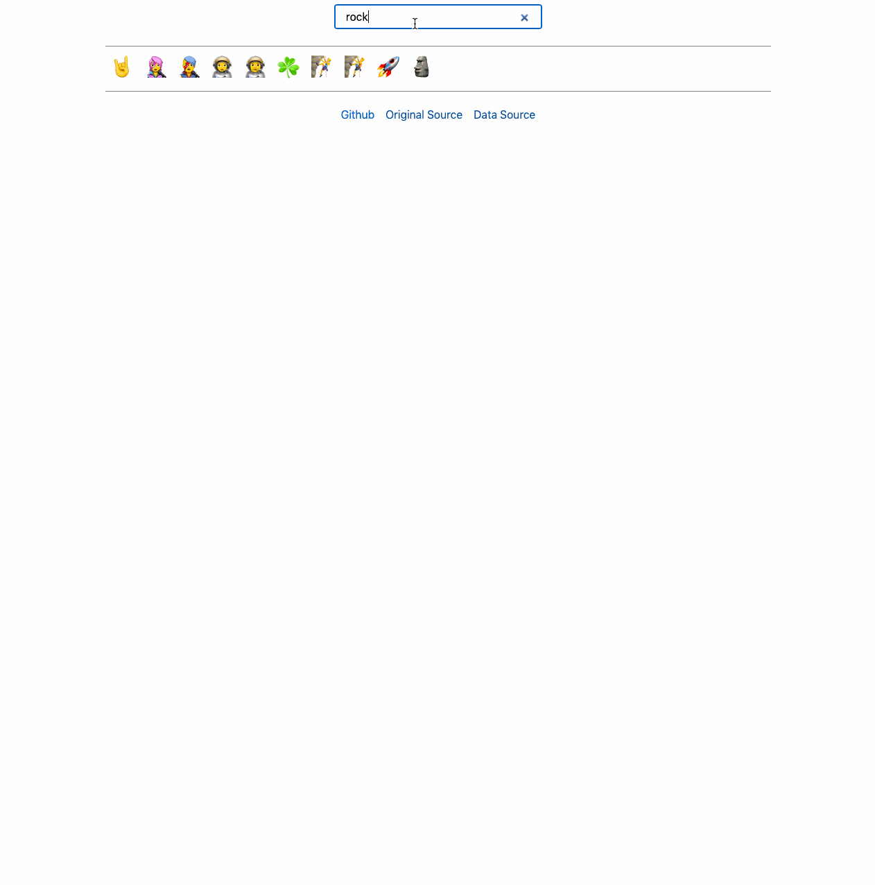

# Emojis Search

Simple emoji search application written in [SvelteKit](https://svelte.dev/docs/kit/introduction).

## Development

Use Node.js 26 (see `.nvmrc`).

Install dependencies with `pnpm install`.

Start the app with `pnpm run dev`.

Build the static site with `pnpm run build`.

Preview the production build with `pnpm run preview`.

Run browser tests against the production build with `pnpm run build && pnpm test`.

## Emoji data and rendering

The first screen prerenders 72 emoji, with 384 lightweight preview records available to fill taller viewports immediately without waiting for the full keyword catalog. After hydration, only the visible rows and a small buffer are mounted; scrolling progressively brings more emoji into view without growing the DOM to the whole catalog. The results region fits the viewport, including smaller mobile windows. Categories are hidden by default behind Categories; exploration mode is preserved in the URL. The full catalog loads separately as soon as the app mounts; there is no artificial startup delay. Search, category and the first visible row (`at`) are reflected in shareable URLs; typing and scrolling replace the current history entry. Themes follow the system setting.

The committed catalog combines [Unicode Emoji 18.0](https://www.unicode.org/Public/18.0.0/emoji/emoji-test.txt) with the latest emojilib keywords (currently 4.0.3). Update deliberately with `pnpm update emojilib --latest && pnpm run update:emojis`, inspect generated changes, then rebuild and test. Data generation needs network access; normal builds use committed data. emojilib is a build-time dependency and is not shipped to browsers.

Unicode data is covered by [the Unicode license](docs/UNICODE-LICENSE.txt); emojilib is MIT licensed. Native glyph appearance and availability depend on the device's OS. No external fonts, emoji images, analytics or runtime APIs are loaded.

See [rendering goals and verification](docs/fast-emoji-search.md).

On desktop, search stays at the top and receives focus on entry. On phones/narrow or touch-only screens, a top-right search button expands into a top search field with a separate close button. Focus is requested synchronously inside the tap handler; the page never opens the mobile keyboard on load. Closing preserves the query in the same toolbar. Opening and closing keep the toolbar height unchanged. Pressed buttons enlarge and change background; animations respect reduced-motion preferences. Only results scroll, while the visual viewport tracks available height and panning.

See [UI incident notes](docs/incidents/README.md) for the mobile keyboard investigation and verification limits.

While mobile search is open, primary pointer taps outside the input and close button prevent the default focus transfer. This keeps the keyboard stable without forcing focus back after blur. Emoji copying and category navigation stay usable; category links disable SvelteKit focus reset for this mode. The close button and keyboard Escape explicitly cancel search. On desktop, emoji clicks also keep the search input focused.

Copy confirmation appears as a compact status in the existing row below search, temporarily replacing the Berlin signature. It stays inside the visible app viewport with the mobile keyboard open, does not shift the grid and never takes focus. Failed copies display “Copy unavailable” instead of a success indicator.
